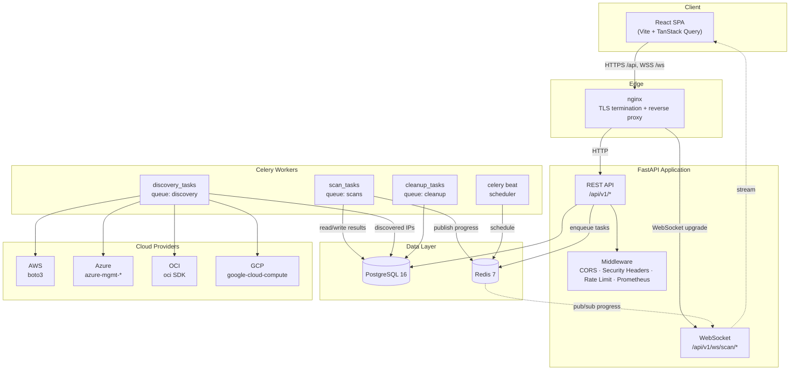

# IPAM Multi-Cloud Security Platform

[](https://github.com/erick/ipam_multicloud/actions/workflows/ci.yml)
[](https://www.python.org/downloads/)
[](https://fastapi.tiangolo.com/)
[](https://react.dev/)
[](LICENSE)

The IPAM Multi-Cloud Security Platform is a production-grade security platform that discovers and scans IP addresses across **AWS**, **Azure**, **OCI**, and **GCP**, assessing the risk of management ports exposed to the internet and analyzing HTTP/HTTPS services. It combines agentless multicloud IP discovery, async TCP port scanning, multi-signal risk classification, and deep HTTP analysis into a single, secure web application with real-time progress streaming.

---

## Features

1. **Multicloud IP Discovery** — Agentless discovery of public and private IPs across all four major clouds. AWS (EC2 instances, Elastic IPs, NAT Gateways, Load Balancers), Azure (Public IPs, NICs, Load Balancers), OCI (VNICs, Load Balancers), and GCP (Instance NICs, Static IPs, Forwarding Rules). Each provider is implemented behind a common abstract interface and resolved through a factory.

2. **Risk Assessment for Management Ports** — Scans 31+ management and administrative ports including FTP (21), SSH/SFTP (22), Telnet (23), RDP (3389), SAP (3200/3300/3601/3901), Citrix (1494/2598), GoGlobal (491), and databases (MySQL 3306, PostgreSQL 5432, MSSQL 1433, Oracle 1521, MongoDB 27017, Redis 6379). Each port is classified as `CRITICAL`, `HIGH`, `MEDIUM`, or `LOW` using a scoring formula that combines a service baseline, exposure multiplier, encryption status, SSL usage, and a CVE penalty.

3. **HTTP/HTTPS Analysis** — Detects static versus dynamic sites by probing known dynamic endpoint patterns, identifies login forms through six independent signals (password input, form action, CAPTCHA widgets, login keywords, 401/403 status, auth URL path), detects rate-limiting (HTTP 429, `Retry-After`, `X-RateLimit-*` headers, latency degradation, body markers), scores security header compliance (0–10), fingerprints server technologies, and extracts TLS certificate details.

4. **Customizable Test Selection** — Users select scan profiles (`quick`, `standard`, `thorough`, `custom`), choose specific ports by category, toggle banner grabbing, HTTP analysis, and rate-limit probing, and select targets manually (IP/CIDR) or from cloud-provider-discovered IPs.

5. **Secure Web Interface** — A React 19 single-page application with JWT authentication, a login page, protected routes, a dashboard with KPI cards and Recharts visualizations, scan management, results visualization, and credential management. Cloud credentials are encrypted at the field level with Fernet before persistence.

6. **Security** — JWT authentication (15-minute access tokens, 7-day refresh tokens), bcrypt password hashing, Fernet field-level encryption for cloud credentials, CORS restricted to explicit origins, TLS termination in nginx, hardened security headers (HSTS, `X-Content-Type-Options`, `X-Frame-Options: DENY`, CSP), per-route and global rate limiting via slowapi, and Prometheus metrics export.

7. **Async Architecture** — Celery workers execute scan and discovery tasks on dedicated queues (`scans`, `discovery`, `cleanup`). Redis serves as both the Celery broker and the pub/sub channel for real-time scan progress, which is streamed to the frontend over authenticated WebSocket connections.

---

## Architecture



---

## Quick Start

### Prerequisites

- [Docker](https://docs.docker.com/get-docker/) 24+
- [Docker Compose](https://docs.docker.com/compose/install/) v2+
- TLS certificates in `nginx/certs/` (`cert.pem` and `key.pem`) — see [Deployment](docs/deployment.md#tls-certificate-generation) to generate self-signed certs

### Steps

```bash
# 1. Clone the repository
git clone <repo-url> ipam_multicloud
cd ipam_multicloud

# 2. Configure environment
cp backend/.env.example .env
# Edit .env — set SECRET_KEY, ENCRYPTION_KEY (Fernet key), ADMIN_EMAIL, ADMIN_PASSWORD

# 3. Generate a Fernet encryption key and put it in .env
python -c "from cryptography.fernet import Fernet; print(Fernet.generate_key().decode())"

# 4. Generate self-signed TLS certificates for local development
mkdir -p nginx/certs
openssl req -x509 -newkey rsa:4096 -nodes -keyout nginx/certs/key.pem \
  -out nginx/certs/cert.pem -days 365 -subj "/CN=localhost"

# 5. Start the full stack (backend, workers, database, redis)
docker compose up -d db redis
docker compose up -d app celery_worker
# Optional: scheduler + frontend (profile-gated services)
docker compose --profile scheduler up -d celery_beat
docker compose --profile frontend up -d frontend

# 6. Run database migrations (seeds the admin user)
docker compose exec app alembic upgrade head

# 7. Open the application
# Frontend:        https://localhost
# API docs (dev):  http://localhost:8000/docs
# Health:          http://localhost:8000/api/v1/health
```

Log in with the admin credentials configured in `.env` (`ADMIN_EMAIL` / `ADMIN_PASSWORD`). The defaults seeded by migration `005` are `admin@ipam.local` / `ChangeMe123!` — **change them immediately in any non-local environment**.

---

## Tech Stack

| Layer | Technology |
|-------|-----------|
| **Backend** | FastAPI 0.115+, Python 3.12, SQLAlchemy 2.0 async (asyncpg), Alembic, Pydantic 2.9+, python-jose (JWT), bcrypt, cryptography (Fernet) |
| **Task Queue** | Celery 5.4+, Redis 7 (broker + result backend + pub/sub) |
| **Database** | PostgreSQL 16 |
| **Scanner** | python-nmap, httpx (async HTTP analysis), custom async TCP port scanner |
| **Cloud SDKs** | boto3 (AWS), azure-mgmt-network + azure-mgmt-resource + azure-identity (Azure), oci (OCI), google-cloud-compute (GCP) |
| **Security** | slowapi (rate limiting), prometheus-fastapi-instrumentator, structlog, Fernet field-level encryption |
| **Frontend** | React 19, Vite 8, TypeScript, Tailwind 4, TanStack Query 5, TanStack Table 8, Zustand 5, React Hook Form 7, Zod 4, Radix UI, Recharts 3, lucide-react, react-router-dom 7 |
| **Infra** | Docker Compose, nginx (TLS termination), pre-commit (ruff, mypy), GitHub Actions CI |

---

## Project Structure

```
ipam_multicloud/
├── backend/
│   ├── app/
│   │   ├── main.py              # FastAPI factory + lifespan
│   │   ├── config.py            # Pydantic Settings (env-driven)
│   │   ├── dependencies.py      # DB session dependency
│   │   ├── core/                # security (JWT, bcrypt, Fernet), database, exceptions, logging
│   │   ├── models/              # SQLAlchemy ORM (User, ScanJob, ScanTarget, PortResult,
│   │   │                        #   HttpAnalysis, IPAddress, CloudProvider, CloudCredential, ScanEvent)
│   │   ├── schemas/             # Pydantic v2 schemas (auth, scan_job, scan_result, analytics, ...)
│   │   ├── scanner/             # port_scanner, http_analyzer, risk_classifier, banner_grabber
│   │   ├── providers/           # aws, azure, oci, gcp providers + factory + base interface
│   │   ├── services/            # scan_service, auth_service, credential_service, cloud_service,
│   │   │                        #   target_service, analytics_service, scan_result_service
│   │   ├── repositories/        # scan, target, cloud, ip_address, port_result repositories
│   │   ├── workers/             # celery_app, scan_tasks, cleanup_tasks, discovery_tasks
│   │   ├── middleware/          # rate_limit, security_headers, request_id
│   │   └── api/v1/endpoints/    # auth, scans, targets, cloud_providers, credentials,
│   │                            #   discovery, analytics, ip_addresses, port_results, health, ws
│   ├── alembic/versions/        # migrations 001–005
│   ├── tests/                   # scanner, api, services, repositories, providers, workers
│   ├── Dockerfile               # Multi-stage FastAPI image (non-root)
│   ├── Dockerfile.celery        # Celery worker image (scans, cleanup, discovery queues)
│   ├── pyproject.toml           # Dependencies, ruff, mypy, pytest config
│   └── requirements.txt
├── frontend/
│   ├── src/
│   │   ├── routes/              # Dashboard, Scans, ScanResults, Targets, Credentials, Settings, Login
│   │   ├── components/          # dashboard/, scans/, layout/, ui/ (15 UI primitives)
│   │   ├── hooks/               # useScans, useTargets, useProviders, useCredentials, useWebSocket
│   │   ├── stores/              # authStore, uiStore, toastStore
│   │   ├── lib/                 # api.ts, websocket.ts, utils.ts
│   │   └── types/               # api, scan, auth, analytics, websocket
│   ├── Dockerfile               # Multi-stage node → nginx
│   ├── nginx.conf               # SPA + API/WS reverse proxy + TLS termination
│   └── package.json
├── nginx/                       # Reverse-proxy nginx.conf + certs/
├── docker-compose.yml           # app, celery_worker, celery_beat, db, redis, frontend
├── .github/workflows/ci.yml     # backend-lint, backend-test, frontend-build
├── Makefile                     # install, dev, test, lint, format, migrate, build, up, down
└── .env.example
```

---

## Development Setup

The project ships with a `Makefile` that wraps the common workflows:

```bash
make install      # Install backend dev dependencies (pip install -e ".[dev]")
make dev          # Start db + redis, then run uvicorn with --reload
make test         # Run pytest with coverage
make lint         # ruff check + ruff format --check
make format       # ruff check --fix + ruff format
make migrate      # alembic upgrade head
make migrate-new name="add foo"  # Create a new autogenerated migration
make build        # docker compose build
make up           # docker compose up -d
make down         # docker compose down
make clean        # Remove __pycache__, .pytest_cache, .ruff_cache, coverage artifacts
```

### Backend (local, without Docker)

```bash
cd backend
python -m venv .venv && source .venv/bin/activate
pip install -e ".[dev]"
# Start a local PostgreSQL and Redis, or: docker compose up -d db redis
cp .env.example ../.env  # then edit DATABASE_URL/REDIS_URL to localhost
alembic upgrade head
uvicorn app.main:app --reload --host 0.0.0.0 --port 8000
# In another terminal:
celery -A app.workers.celery_app worker --loglevel=info \
  --queues=scans,cleanup,discovery
```

### Frontend

```bash
cd frontend
npm install
npm run dev      # Vite dev server on http://localhost:5173
```

Set `VITE_API_BASE_URL` to the backend origin (defaults to `http://localhost:8000`). See [`frontend/README.md`](frontend/README.md) for full details.

---

## Testing

```bash
# Backend tests with coverage (uses pytest-asyncio, aiosqlite for fast tests)
cd backend && pytest -v

# With the HTML coverage report
pytest --cov-report=html && open htmlcov/index.html
```

Tests are organized by layer under `backend/tests/`: `test_scanner`, `test_api`, `test_services`, `test_repositories`, `test_providers`, and `test_workers`. Async tests run in `asyncio_mode = "auto"`. Coverage targets the `app` package and is reported as `term-missing` and XML.

The CI pipeline (see below) runs the full backend test suite against PostgreSQL 16 and Redis 7 service containers.

---

## CI/CD

The GitHub Actions workflow (`.github/workflows/ci.yml`) runs on pushes to `main`/`develop` and pull requests to `main`. It defines three jobs:

| Job | Description |
|-----|-------------|
| **backend-lint** | Installs the backend with dev extras, runs `ruff check`, `ruff format --check`, and `mypy app`. |
| **backend-test** | Spins up PostgreSQL 16 and Redis 7 service containers, installs the backend, and runs `pytest` with a real Fernet key and test database URL. |
| **frontend-build** | Installs npm dependencies, runs `tsc --noEmit`, builds the Vite production bundle, and lints with ESLint. |

Pre-commit hooks (`ruff`, `mypy`) run the same checks locally before each commit.

---

## Documentation

| Document | Description |
|----------|-------------|
| [docs/architecture.md](docs/architecture.md) | System design, data flow, scanning pipeline, database schema |
| [docs/security.md](docs/security.md) | Credential encryption, JWT auth, rate limiting, TLS, responsible scanning |
| [docs/api.md](docs/api.md) | Full REST + WebSocket API reference with examples |
| [docs/deployment.md](docs/deployment.md) | Docker Compose deployment, TLS, nginx, production hardening |
| [docs/metrics.md](docs/metrics.md) | Success metrics, Prometheus, Grafana, alerting |
| [docs/timeline.md](docs/timeline.md) | Phase-by-phase implementation timeline |
| [backend/README.md](backend/README.md) | Backend-specific developer guide |
| [frontend/README.md](frontend/README.md) | Frontend-specific developer guide |

---

## License

MIT
