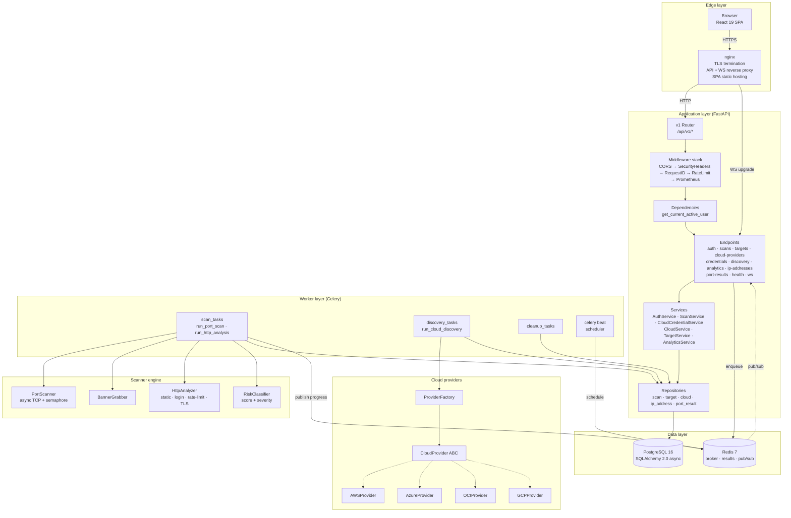
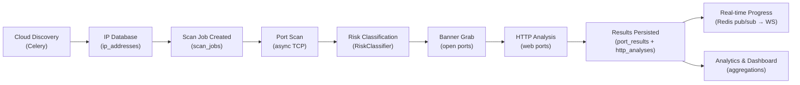
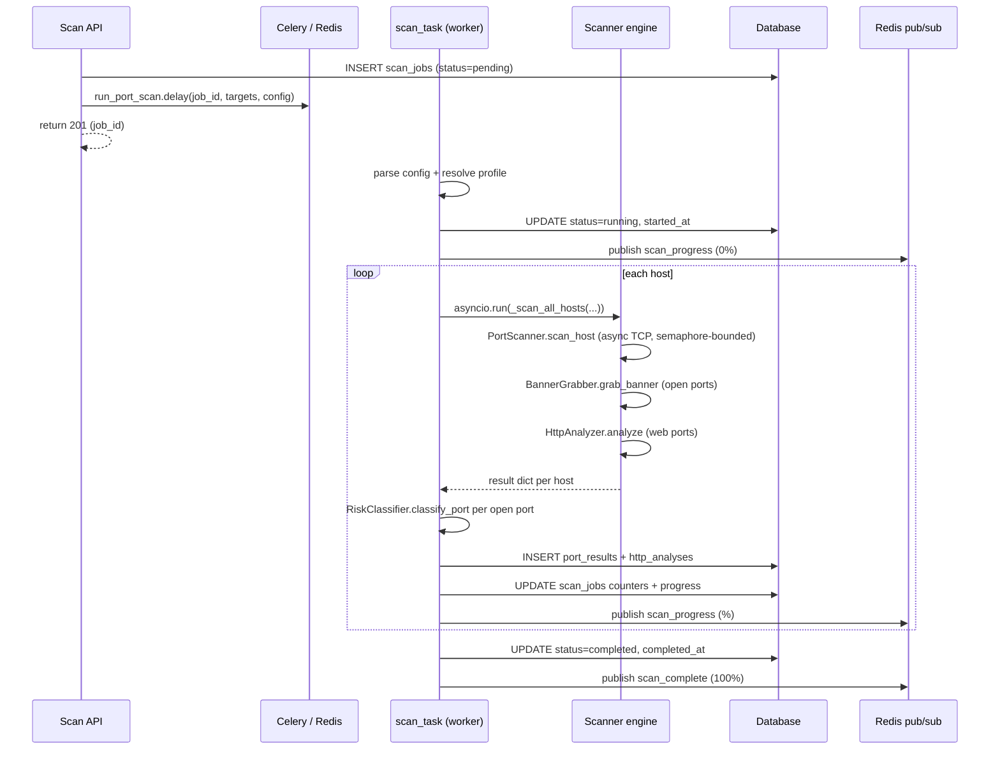
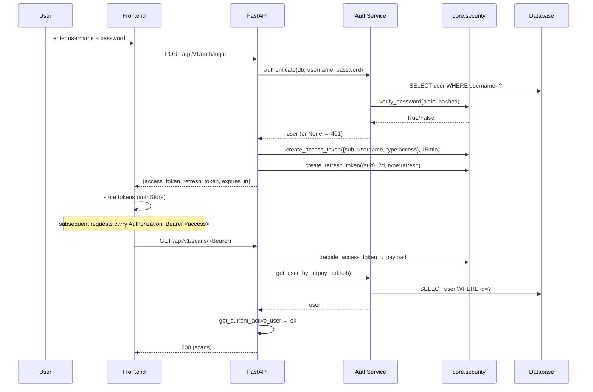
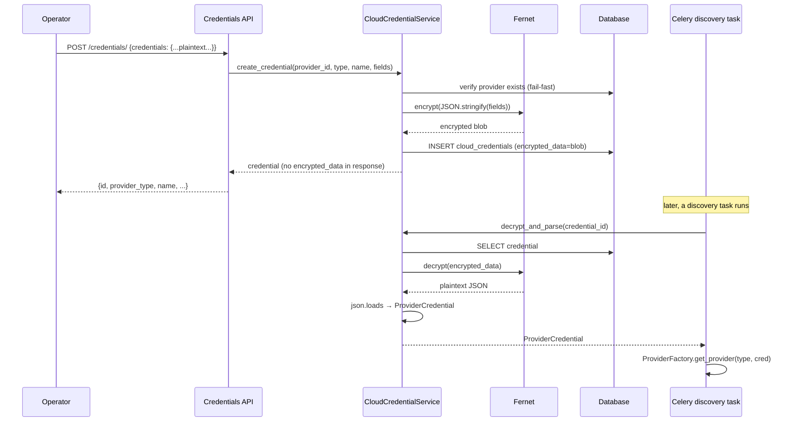
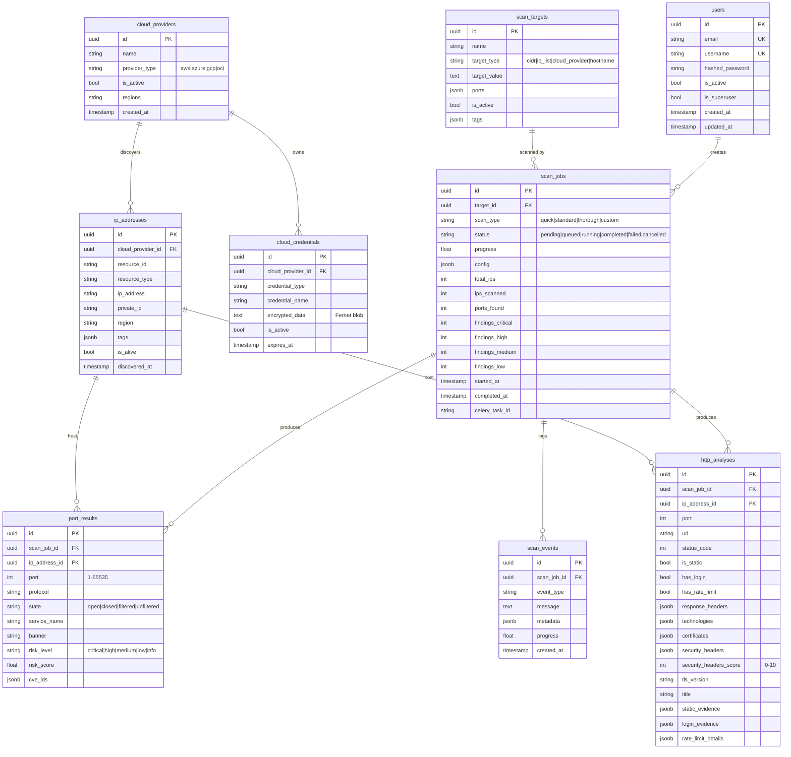

# Architecture

This document describes the system design of the IPAM Multi-Cloud Security Platform: the component model, the end-to-end data flow, the multicloud discovery pattern, the async scanning pipeline, the authentication and credential-encryption flows, and the database schema.

---

## System Design Overview

The platform is a three-tier async system: a React SPA at the edge, a FastAPI application in the middle, and a PostgreSQL + Redis data layer at the bottom. Long-running work (scanning, discovery, cleanup) is offloaded to Celery workers so the API stays responsive.



### Layer responsibilities

| Layer | Responsibility |
|-------|----------------|
| **Edge (nginx)** | TLS termination, HTTP→HTTPS redirect, static SPA hosting with `try_files` fallback, reverse proxy for `/api/` and `/ws/`, security headers, long timeout for scan requests and WebSockets. |
| **API (FastAPI)** | Request parsing and validation at the boundary (Pydantic), authentication, orchestration of services, pagination, error mapping with stable `code` values. No business logic in endpoints — they delegate to services. |
| **Services** | Business logic. `ScanService` creates scan jobs and dispatches Celery tasks; `CloudCredentialService` encrypts/decrypts credentials; `AuthService` issues tokens; `AnalyticsService` runs aggregation queries. |
| **Repositories** | Data access. Thin async wrappers over SQLAlchemy `select`/`insert`/`update` queries, keeping ORM details out of services. |
| **Workers (Celery)** | Long-running execution: TCP port scanning, banner grabbing, HTTP analysis, risk classification, result persistence, and cloud discovery. Publishes progress to Redis for real-time streaming. |
| **Scanner engine** | Pure async I/O modules with no database access — they return structured result dicts/objects that the worker persists. |
| **Providers** | Agentless cloud enumeration behind a common `CloudProvider` ABC, resolved by a factory. Each provider runs blocking SDK calls in an executor to avoid blocking the event loop. |

---

## Data Flow

The canonical flow from cloud discovery through to results visualization:



1. **Cloud Discovery.** An operator registers a cloud provider and its (encrypted) credentials, then `POST /api/v1/discovery/run` enqueues a `run_cloud_discovery` Celery task on the `discovery` queue.
2. **IP Database.** The discovery task instantiates the provider via the factory, calls `discover_ip_addresses`, `discover_security_rules`, and `discover_load_balancers`, and upserts the discovered IPs into the `ip_addresses` table.
3. **Scan Job.** An operator creates a scan target (CIDR, IP list, hostname, or cloud provider) and submits a scan job (`POST /api/v1/scans/`). `ScanService` inserts a `scan_jobs` row and dispatches `run_port_scan` on the `scans` queue.
4. **Port Scan.** The Celery task resolves each target host to an `ip_addresses` row, then runs `PortScanner.scan_host` — async TCP connect probes bounded by an internal semaphore — across the profile's port list.
5. **Risk Classification.** Every open port is classified by `RiskClassifier.classify_port`, which combines a service baseline score, exposure multiplier, encryption multiplier, SSL multiplier, and CVE penalty into a final 0–10 score mapped to `CRITICAL`/`HIGH`/`MEDIUM`/`LOW`.
6. **Banner Grab + HTTP Analysis.** For open ports, the task optionally grabs the service banner (disambiguating SSH vs SFTP on port 22) and, for web ports (`80, 443, 8080, 8443`), runs `HttpAnalyzer.analyze` to detect static/dynamic content, login forms, rate-limiting, security headers, technology fingerprints, and TLS certificate info.
7. **Results Persisted.** Each port outcome is stored as a `port_results` row; each HTTP analysis as an `http_analyses` row. Running counters (`ports_found`, `findings_critical`, etc.) are updated on the `scan_jobs` row after each host.
8. **Real-time Progress.** After each host, the task publishes a JSON message to the Redis channel `scan:progress:{scan_job_id}`. The WebSocket endpoint subscribes to that channel and forwards messages to connected clients.
9. **Analytics & Dashboard.** The `AnalyticsService` and `ScanRepository.get_dashboard_stats` run aggregate queries (timeline, port distribution, risk summary, KPI counts) that power the dashboard charts and KPI cards.

---

## Multicloud Discovery Pattern

Discovery is **agentless** — no software is installed inside the cloud accounts. Each provider uses the official cloud SDK authenticated with credentials the operator supplies (and which are Fernet-encrypted at rest).

### Abstract interface

Every provider implements the `CloudProvider` ABC (`app/providers/base.py`):

```python
class CloudProvider(ABC):
    async def discover_ip_addresses(self) -> list[DiscoveredIP]: ...
    async def discover_security_rules(self) -> list[SecurityRule]: ...
    async def discover_load_balancers(self) -> list[LBEndpoint]: ...
    async def health_check(self) -> bool: ...
    async def get_regions(self) -> list[str]: ...
```

A shared `_run_in_executor` helper runs the blocking SDK calls (which are synchronous in boto3, the Azure SDK, the OCI SDK, and the GCP SDK) on the default executor so the async event loop is never blocked.

### Factory resolution

`ProviderFactory.get_provider(provider_type, credential)` maps a provider-type string (`aws`, `azure`, `gcp`, `oci`) to the concrete class. Unknown types raise `ValueError` at the boundary so internal code receives a trusted `CloudProvider` instance.

### Per-provider enumeration

| Provider | SDK | Enumeration sources |
|----------|-----|---------------------|
| **AWS** | `boto3` | EC2 instances, Elastic IPs, NAT Gateways, Load Balancers |
| **Azure** | `azure-mgmt-network`, `azure-mgmt-resource`, `azure-identity` | Public IPs, NICs, Load Balancers |
| **OCI** | `oci` | VNICs, Load Balancers |
| **GCP** | `google-cloud-compute` | Instance NICs, Static IPs, Forwarding Rules |

Each provider returns `DiscoveredIP` dataclass instances (carrying `ip_address`, `private_ip`, `resource_id`, `resource_type`, `region`, `hostname`, `tags`), plus `SecurityRule` and `LBEndpoint` records for firewall and load-balancer context. A shared `retry` helper in `app/providers/retry.py` wraps transient SDK failures.

---

## Scanning Pipeline

Scanning runs entirely inside a Celery task (`run_port_scan` in `app/workers/scan_tasks.py`). The task is the orchestrator; the scanner modules are pure async I/O with no database access.

### Phases



### Key design decisions

- **Single event loop for the whole batch.** All hosts are scanned concurrently via `asyncio.gather` inside one `asyncio.run` call, so the event loop is created once instead of per host. The `PortScanner`'s internal semaphore already caps concurrent socket connections, so batching hosts does not overwhelm the network.
- **Pure-async scanner, sync persistence.** The scanner engine performs only async I/O and returns structured result objects. The (synchronous) Celery task handles all database writes through `ScanResultService`, keeping the event loop free of blocking DB calls.
- **Graceful per-host degradation.** `asyncio.gather(..., return_exceptions=True)` surfaces per-host failures as `Exception` values. A failed host is logged, published as a progress event, and skipped — it never aborts the batch.
- **Lazy imports.** Scanner classes are imported inside the task body so Celery worker startup is not blocked by scanner/engine initialization.
- **SSH/SFTP disambiguation.** Port 22 is reported as `SSH/SFTP` when the grabbed banner contains `"sftp"`, since SSH and SFTP share port 22.
- **Time limits.** Celery enforces a 600-second soft time limit and a 900-second hard time limit per task. `acks_late=True` and `reject_on_worker_lost=True` ensure lost workers do not silently drop scans.

### Scan profiles

Profiles (`app/schemas/scan_profiles.py`) bundle a port list with scanning behavior so callers select a name instead of raw config:

| Profile | Ports | Timeout | Concurrency | Banner grab | HTTP analysis |
|---------|-------|---------|-------------|-------------|---------------|
| `quick` | Top 10 admin ports | 1.0s | 500 | No | No |
| `standard` | Top 31+ admin ports | 2.0s | 200 | Yes | Yes |
| `thorough` | Ports 1–1024 + key admin ports | 3.0s | 100 | Yes | Yes |
| `custom` | Caller-supplied | 2.0s | 200 | Yes | Yes |

### Progress streaming

After each host, `publish_progress` writes a JSON message shaped to the frontend `WsMessage` contract to Redis with a 10-minute expiry, and publishes it on the `scan:progress:{scan_job_id}` channel:

```json
{
  "type": "scan_progress",
  "scan_job_id": "<uuid>",
  "timestamp": "<iso-8601>",
  "payload": {
    "task_id": "<celery-id>",
    "progress": 42.0,
    "status": "running",
    "message": "Scanned 10.0.0.5 — found 3 open port(s)",
    "data": {"current_host": "10.0.0.5", "ports_found_this_host": 3}
  }
}
```

The internal status label is mapped to the WebSocket `type` (`scan_progress`, `scan_complete`, `scan_error`, `scan_cancelled`) so the worker keeps passing internal status strings while the frontend receives the contract types it expects.

---

## Authentication Flow



See [security.md](security.md#jwt-authentication) for the token lifetimes, claims, and the dependency chain that enforces authorization.

---

## Credential Encryption Flow



The encrypted blob is never included in any API response. Decryption happens only inside the worker process, immediately before provider instantiation, and the decrypted `ProviderCredential` is never persisted or logged.

---

## Database Schema Overview

The schema is managed by Alembic (migrations `001`–`005`) and uses PostgreSQL `UUID`, `JSONB`, and `TIMESTAMP WITH TIME ZONE` types. All primary keys are UUIDs generated in the application.



### Key relationships

- A `ScanTarget` (CIDR, IP list, hostname, or cloud provider reference) owns many `ScanJobs`.
- A `ScanJob` produces many `PortResults` and `HttpAnalyses`, and logs an append-only stream of `ScanEvents`.
- `PortResult` and `HttpAnalysis` both reference the `ScanJob` and the `IPAddress` they pertain to, with `ondelete="CASCADE"` so deleting a scan job removes its findings.
- `IPAddress` optionally belongs to a `CloudProvider` (`ondelete="SET NULL"`), so deleting a provider retains the IP history.
- `CloudCredential` belongs to a `CloudProvider` with cascade delete — removing a provider removes its encrypted credentials.

### Migrations

| Migration | Description |
|-----------|-------------|
| `001_initial_schema` | Base tables: `scan_targets`, `scan_jobs`, `ip_addresses`, `port_results`, `cloud_providers` |
| `002_add_scan_profiles` | Scan profile column on `scan_jobs` |
| `003_add_http_analysis_fields` | `http_analyses` table and static/login/rate-limit/headers/TLS columns |
| `004_add_users_table` | `users` table for JWT authentication |
| `005_seed_admin_user` | Seeds the initial superuser from `ADMIN_EMAIL` / `ADMIN_PASSWORD` (with bcrypt hashing) |
