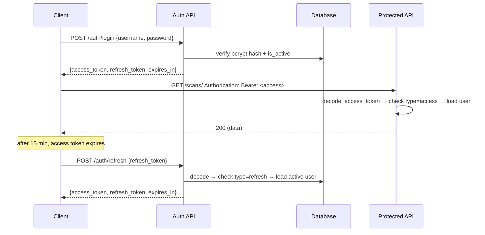

# Security

This document describes the security architecture of the IPAM Multi-Cloud Security Platform: how credentials are protected, how authentication and authorization work, how the platform is hardened at the HTTP and transport layers, and the operational guidelines for responsible scanning.

---

## Credential Encryption

Cloud provider credentials (AWS access keys, Azure service principals, OCI config, GCP service accounts, API keys) are **encrypted at the field level** before they ever reach the database. No plaintext credential material is persisted.

### Fernet symmetric encryption

The platform uses [Fernet](https://cryptography.io/en/latest/fernet/) (from the `cryptography` package) — authenticated symmetric encryption (AES-128-CBC with HMAC-SHA256). Encryption and decryption are handled by `app.core.security` and the `CloudCredentialService`.

**Key derivation.** The `ENCRYPTION_KEY` setting is expected to be a valid Fernet key (32 URL-safe base64 bytes). When the raw value is not a valid Fernet key — common in local development — a valid key is derived by SHA-256 hashing the raw value and base64-encoding the digest:

```python
# app/core/security.py — _get_fernet()
try:
    fernet = Fernet(raw_key)
except (ValueError, TypeError):
    derived = base64.urlsafe_b64encode(hashlib.sha256(raw_key).digest())
    fernet = Fernet(derived)
```

The same fallback is mirrored in `CloudCredentialService._build_fernet` so both code paths derive identical keys for the same input.

> **Production requirement.** Always generate a real Fernet key with
> `python -c "from cryptography.fernet import Fernet; print(Fernet.generate_key().decode())"`
> and set it as `ENCRYPTION_KEY`. Rotating the key invalidates all previously encrypted credentials, so plan a re-encryption migration before rotating.

### Encryption flow

1. A client `POST /api/v1/credentials/` sends plaintext credential fields in the `credentials` dict.
2. `CloudCredentialService.create_credential` verifies the owning provider exists (fail-fast), then `encrypt_and_store` JSON-serializes the fields and Fernet-encrypts the blob.
3. The encrypted blob is stored in `cloud_credentials.encrypted_data`. Response schemas (`CredentialResponse`) **never** include the encrypted blob — only metadata (`id`, `provider_type`, `name`, timestamps).
4. When a Celery discovery task needs the credential, `decrypt_and_parse` decrypts the blob and returns a `ProviderCredential` ready to hand to the provider SDK. Decryption failures are logged and the credential is skipped rather than crashing the task.

---

## JWT Authentication

### Token types

| Token | Lifetime | Claim `type` | Purpose |
|-------|----------|--------------|---------|
| Access token | 15 minutes | `access` | Sent as `Authorization: Bearer <token>` on every protected request. |
| Refresh token | 7 days | `refresh` | Sent to `POST /api/v1/auth/refresh` to obtain a new token pair. |

Both tokens are signed with `SECRET_KEY` using `HS256` (configurable via `JWT_ALGORITHM`). Tokens carry a `sub` claim (the user UUID), `exp`, and the `type` discriminator. The access token also carries `username`.

### Flow



### Dependency chain

Authentication is enforced through a single FastAPI dependency chain in `app/api/deps.py`:

```
oauth2_scheme → get_current_user → get_current_active_user → require_superuser
```

- `get_current_user` decodes the bearer token (via `OAuth2PasswordBearer` with `tokenUrl="/api/v1/auth/login"`), rejects tokens that are missing, expired, not of `type=access`, or reference an unknown user — each with a 401 and a stable `code`.
- `get_current_active_user` returns 403 if the user's `is_active` flag is `False`.
- `require_superuser` returns 403 if `is_superuser` is `False`.

All domain routers (`scans`, `targets`, `cloud-providers`, `credentials`, `discovery`, `analytics`, `ip-addresses`, `port-results`) are mounted with `dependencies=[Depends(get_current_active_user)]` at the v1 router level. The `auth` and `health` routers are public.

### WebSocket authentication

WebSocket clients cannot send custom HTTP `Authorization` headers, so the JWT access token is validated from the `token` query parameter instead:

```
GET /api/v1/ws/scan/{scan_job_id}?token=<jwt>
```

The handler decodes the token and checks `payload.get("type") == "access"`. Invalid or missing tokens close the connection with application code `4401` (the `4xxx` range reserved for application use, mirroring HTTP 401 semantics).

---

## Password Hashing

Passwords are hashed with **bcrypt** (via the `bcrypt` package directly, not the unmaintained `passlib` wrapper, which is incompatible with bcrypt 5.x). A fresh random salt is generated per hash with `bcrypt.gensalt()`.

- `hash_password(plain)` → `bcrypt.hashpw(plain.encode(), bcrypt.gensalt()).decode()`
- `verify_password(plain, hashed)` → `bcrypt.checkpw(...)`, returning `False` for any malformed hash (fail-loud at the boundary, predictable boolean for callers).

The `User.hashed_password` column stores only the bcrypt hash; plaintext passwords are never logged or persisted. The seeded admin user (migration `005`) is hashed with the same bcrypt routine at migration time.

---

## Rate Limiting

Rate limiting is implemented with [slowapi](https://slowapi.readthedocs.io/) and registered as ASGI middleware so every route is protected by the global default. The limiter is keyed by remote IP address.

| Scope | Limit | Where |
|-------|-------|-------|
| Registration | 5 requests / minute / IP | `@rate_limiter.limit("5/minute")` on `POST /auth/register` |
| Login | 10 requests / minute / IP | `@rate_limiter.limit("10/minute")` on `POST /auth/login` |
| Global default | 100 requests / minute / IP | `rate_limiter.default_limits=[settings.GLOBAL_RATE_LIMIT]` |

Rate limiting is **disabled in debug mode** (`enabled=not settings.DEBUG`) to avoid interfering with local development and test runs. When a limit is exceeded, slowapi returns a `429 Too Many Requests` response via the registered `RateLimitExceeded` handler.

The `AUTH_RATE_LIMIT` and `GLOBAL_RATE_LIMIT` settings are configurable through environment variables.

---

## Security Headers

Two layers add security headers to every HTTP response.

### Application middleware (`SecurityHeadersMiddleware`)

`app/middleware/security_headers.py` injects these headers on every response from the FastAPI app:

| Header | Value |
|--------|-------|
| `Strict-Transport-Security` | `max-age=63072000; includeSubDomains` (2 years) |
| `X-Content-Type-Options` | `nosniff` |
| `X-Frame-Options` | `DENY` |
| `Referrer-Policy` | `strict-origin-when-cross-origin` |
| `Content-Security-Policy` | `default-src 'self'; script-src 'self'; style-src 'self' 'unsafe-inline'; img-src 'self' data:; font-src 'self' data:; connect-src 'self'` |

### nginx

The nginx reverse proxy (`nginx/nginx.conf` and `frontend/nginx.conf`) adds `Strict-Transport-Security`, `X-Content-Type-Options`, `X-Frame-Options: DENY`, `X-XSS-Protection: 1; mode=block`, and `Referrer-Policy` with the `always` qualifier so they are emitted even on error responses.

---

## CORS Configuration

CORS is configured explicitly — **never with a wildcard origin**. The `CORS_ORIGINS` setting is a list of exact origin strings:

```python
CORS_ORIGINS: list[str] = [
    "http://localhost:5173",
    "http://localhost:3000",
    "http://localhost:8080",
]
```

The `CORSMiddleware` is registered with `allow_credentials=True`, `allow_methods=["*"]`, and `allow_headers=["*"]`. Combining `allow_credentials=True` with a wildcard origin is a CORS bypass vulnerability — browsers reject credentialed wildcard requests, but origin-reflecting middleware can still leak credentials. The platform therefore requires operators to list every permitted origin explicitly via the `CORS_ORIGINS` environment variable.

> Override `CORS_ORIGINS` in `.env` for any non-local deployment. Add only the exact frontend origin(s) you serve from.

---

## TLS / HTTPS Termination

TLS terminates at nginx; traffic between nginx and the FastAPI backend on the private Docker network is plain HTTP.

- **Protocols:** `TLSv1.2` and `TLSv1.3` only (`ssl_protocols TLSv1.2 TLSv1.3;`). Older protocols are not negotiated.
- **Ciphers:** `HIGH:!aNULL:!MD5` with `ssl_prefer_server_ciphers on`.
- **HTTP → HTTPS redirect:** The port-80 server block issues a `301` to `https://$host$request_uri` for every request.
- **Certificate location:** Certificates are mounted read-only at `/etc/nginx/certs/cert.pem` and `/etc/nginx/certs/key.pem` from the host `./nginx/certs/` directory.
- **Self-signed cert generation** for local development is documented in [deployment.md](deployment.md#tls-certificate-generation).

The backend `SecurityHeadersMiddleware` adds HSTS so that once a browser has visited the site over HTTPS, subsequent requests are forced to HTTPS for the next two years (including subdomains).

---

## WebSocket Authentication

WebSocket connections to `/api/v1/ws/scan/{scan_job_id}` require a valid JWT access token supplied as the `token` query parameter. The handler:

1. Reads `token` from `websocket.query_params`.
2. Decodes it with `decode_access_token`; on any failure or a missing `type=access` claim, closes the connection with code `4401` and reason `"Invalid or missing token"`.
3. Subscribes to the Redis pub/sub channel `scan:progress:{scan_job_id}` and forwards every published message to the client.

This means a compromised or expired token cannot subscribe to scan progress, and the token's lifetime (15 minutes) bounds the maximum WebSocket session without a reconnect-and-refresh cycle.

---

## Responsible Scanning Guidelines

The IPAM Multi-Cloud Security Platform performs active network scanning (TCP connect probes, banner grabbing, HTTP requests, TLS handshakes). Operators are responsible for ensuring scans are authorized and proportionate.

1. **Written authorization.** Only scan IP ranges and cloud assets you own or have explicit written authorization to assess. Scanning third-party systems without authorization may be illegal in your jurisdiction.
2. **Approved scan windows.** Schedule scans during maintenance windows or low-traffic periods. The `thorough` profile probes ports 1–1024 plus administrative ports and can generate noticeable connection volume.
3. **Rate and concurrency controls.** Each scan profile defines a `timeout` and `concurrency` cap. The `PortScanner` enforces an internal semaphore so concurrent connections never exceed the configured limit. Tune `MAX_CONCURRENT_SCANS` and the profile `concurrency` to match your network's tolerance.
4. **Retention controls.** The `SCAN_RETENTION_DAYS` setting (default 90 days) controls how long terminal scan jobs are retained before the cleanup task purges them. Lower this value if your data-retention policy requires shorter persistence.
5. **Credential scope.** Use least-privilege cloud credentials for discovery. Read-only IAM roles are sufficient for IP enumeration and security-group discovery; the platform never modifies cloud resources.
6. **Burst probing awareness.** The HTTP analyzer sends a configurable burst of requests (`BURST_COUNT = 10`) to detect rate-limiting. Be aware this multiplies request volume against web ports — disable HTTP analysis (`http_analysis: false`) for sensitive targets.

---

## Compliance Mapping

The platform's controls map to widely-used security frameworks. This mapping is informational and not a certification.

### OWASP Top 10 (2021)

| OWASP Risk | Platform control |
|------------|------------------|
| A01 — Broken Access Control | JWT auth, dependency-chain authorization, per-router `get_current_active_user`, WebSocket token validation |
| A02 — Cryptographic Failures | Fernet field-level encryption for credentials, bcrypt password hashing, TLS 1.2/1.3 termination, HSTS |
| A03 — Injection | SQLAlchemy parameterized queries, Pydantic v2 input validation at the boundary |
| A04 — Insecure Design | Explicit CORS origins (no wildcard + credentials), fail-loud exception hierarchy with stable error codes |
| A05 — Security Misconfiguration | Security headers middleware, non-root Docker user, debug docs disabled in production (`docs_url=None` when `DEBUG=False`) |
| A07 — Identification & Authentication Failures | bcrypt hashing, 15-min access tokens, per-IP rate limits on register/login, generic login error messages |
| A08 — Software & Data Integrity Failures | Pre-commit hooks, CI lint + type-check + test gates, pinned dependencies |
| A09 — Security Logging & Monitoring Failures | structlog structured logging, Prometheus metrics, append-only `ScanEvent` audit log |
| A10 — Server-Side Request Forgery | Scanner targets are explicit user-provided or cloud-discovered IPs; no unvalidated URL fetching from user input |

### CIS Benchmarks (applicable controls)

| CIS Area | Platform control |
|----------|------------------|
| Secure Configuration | Non-root container user (`appuser`, UID 1001), minimal runtime images, no debug tools in runtime stage |
| Access Control | JWT + RBAC dependency chain, superuser-only operations where applicable |
| Logging | Structured JSON logs via structlog, request IDs via `RequestIDMiddleware` |
| Network Security | TLS termination, HTTP→HTTPS redirect, CSP, `X-Frame-Options: DENY` |
| Data Protection | Credential encryption at rest, no plaintext secrets in responses, password hashing |
