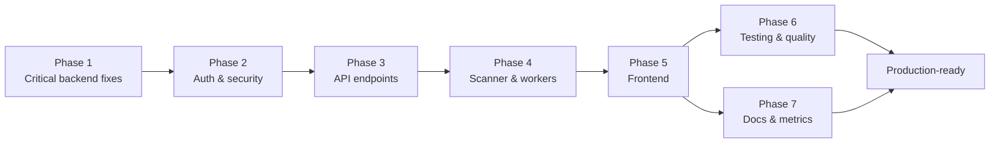

# Implementation Timeline

This document tracks the phase-by-phase implementation of the IPAM Multi-Cloud Security Platform, including deliverables, status, dependencies, and total estimated duration.

---

## Phase Summary

| Phase | Duration | Status | Key Deliverables |
|-------|----------|--------|------------------|
| **Phase 1** | 3–4 days | COMPLETE | Critical backend fixes — async session handling, repository layer, scan result persistence, error mapping |
| **Phase 2** | 3–4 days | COMPLETE | Auth system + security hardening — JWT (access + refresh), bcrypt, Fernet field-level encryption, security headers, rate limiting, CORS |
| **Phase 3** | 3–4 days | COMPLETE | API endpoints + contract alignment — scans, targets, cloud-providers, credentials, discovery, analytics, ip-addresses, port-results, health, ws |
| **Phase 4** | 3–4 days | COMPLETE | Scanner & worker enhancements — scan profiles, async batch scanning, banner grabbing, SSH/SFTP disambiguation, HTTP analysis, Redis pub/sub progress |
| **Phase 5** | 4–5 days | COMPLETE | Frontend completion — React 19 SPA, login, protected routes, dashboard with KPI cards and charts, scan management, results, credentials |
| **Phase 6** | 3–4 days | IN PROGRESS | Testing & quality — scanner, API, services, repositories, providers, workers test suites; coverage; CI |
| **Phase 7** | 2–3 days | IN PROGRESS | Documentation & metrics — this documentation set, Prometheus metrics, Grafana dashboard, alerting |
| **Total** | ~20–27 days | — | Full production-grade platform |

---

## Gantt Chart

```mermaid
gantt
    title IPAM Multi-Cloud Security Platform — Implementation Timeline
    dateFormat  YYYY-MM-DD
    axisFormat  %b %d

    section Backend
    Phase 1: Critical backend fixes          :done,    p1, 2026-05-26, 4d
    Phase 2: Auth & security hardening       :done,    p2, after p1, 4d
    Phase 3: API endpoints & contracts       :done,    p3, after p2, 4d
    Phase 4: Scanner & worker enhancements   :done,    p4, after p3, 4d

    section Frontend
    Phase 5: Frontend completion             :done,    p5, after p4, 5d

    section Quality & Docs
    Phase 6: Testing & quality               :active,  p6, after p5, 4d
    Phase 7: Documentation & metrics         :active,  p7, after p5, 3d
```

> Phases 6 and 7 run in parallel after Phase 5 since documentation and test hardening are largely independent. The chart shows them sequenced for clarity, but they overlap in practice.

---

## Phase Dependencies



### Why the ordering

- **Phase 1 → Phase 2:** Authentication and credential encryption build on the stabilized data layer and error-handling foundation from Phase 1. You cannot securely handle credentials before the repository and session layer are correct.
- **Phase 2 → Phase 3:** API endpoints are mounted with `dependencies=[Depends(get_current_active_user)]`, so the JWT dependency chain must exist before endpoint work begins.
- **Phase 3 → Phase 4:** The scanner and worker tasks persist results through the scan-result service and repositories finalized in Phase 3. The scan-task → WebSocket message contract (`scan_progress`, `scan_complete`, etc.) is defined alongside the endpoints it serves.
- **Phase 4 → Phase 5:** The frontend consumes the REST and WebSocket contracts established in Phases 3 and 4. TanStack Query hooks and the WebSocket store depend on stable response shapes and message types.
- **Phase 5 → Phase 6 & 7:** Testing and documentation are most valuable against a complete, stable surface. Running them in parallel after Phase 5 avoids rework from contract drift.

---

## Detailed Deliverables

### Phase 1 — Critical Backend Fixes (COMPLETE)

- Async SQLAlchemy 2.0 session management with `asyncpg`
- Repository pattern (`scan`, `target`, `cloud`, `ip_address`, `port_result`)
- Scan result persistence (`ScanResultService`)
- Structured exception hierarchy with stable `code` values (`AppException` → 404/400/401/403/409/422/502)
- Centralized `register_exception_handlers` (never leaks internals on 500)
- `structlog` structured logging configuration

### Phase 2 — Auth System & Security Hardening (COMPLETE)

- `User` model and `users` table (migration `004`)
- bcrypt password hashing (direct `bcrypt`, not `passlib`)
- JWT access tokens (15 min) + refresh tokens (7 days) via `python-jose`
- `OAuth2PasswordBearer` dependency chain (`get_current_user` → `get_current_active_user` → `require_superuser`)
- Fernet field-level encryption for cloud credentials with SHA-256 key-derivation fallback
- `SecurityHeadersMiddleware` (HSTS, CSP, X-Frame-Options DENY, nosniff, Referrer-Policy)
- slowapi rate limiting (5/min register, 10/min login, 100/min global)
- Explicit-only CORS origins
- Seeded admin user (migration `005`)

### Phase 3 — API Endpoints & Contract Alignment (COMPLETE)

- v1 router aggregation under `/api/v1`
- `auth`, `scans`, `targets`, `cloud-providers`, `credentials`, `discovery`, `analytics`, `ip-addresses`, `port-results`, `health`, `ws` endpoints
- Pydantic v2 schemas with `from_attributes` ORM mapping
- `PaginatedResponse[T]` generic with frontend-compatible `size`/`pages` aliases
- Dashboard stats endpoint (`/scans/stats`) registered before `/{scan_id}` to avoid UUID collision
- Discovery dispatch via Celery with status polling
- WebSocket endpoint with JWT query-param auth and Redis pub/sub forwarding

### Phase 4 — Scanner & Worker Enhancements (COMPLETE)

- Named scan profiles (`quick`, `standard`, `thorough`, `custom`) in `scan_profiles.py`
- Async batch scanning — single event loop for all hosts via `asyncio.gather`
- `PortScanner` with semaphore-bounded concurrency
- `BannerGrabber` with SSH/SFTP disambiguation on port 22
- `HttpAnalyzer` — static detection, 6-signal login detection, rate-limit burst probing, security-header scoring (0–10), technology fingerprinting, TLS certificate extraction
- `RiskClassifier` — baseline × exposure × encryption × SSL × CVE scoring → CRITICAL/HIGH/MEDIUM/LOW
- Redis pub/sub progress publishing (`scan:progress:{scan_job_id}` channel, 10-min expiry)
- Celery queue topology (`scans`, `cleanup`, `discovery`) with time limits (600s soft / 900s hard)
- Graceful per-host degradation (`return_exceptions=True`)

### Phase 5 — Frontend Completion (COMPLETE)

- React 19 + Vite 8 + TypeScript SPA
- Login page, JWT auth store (Zustand), protected routes
- Dashboard with KPI cards (`KpiCard`) and Recharts visualizations
- Scan management (`ScanForm`, `ScanProgress`, `ScanResults`)
- Targets, Credentials, Settings pages
- TanStack Query 5 hooks (`useScans`, `useTargets`, `useProviders`, `useCredentials`, `useWebSocket`)
- TanStack Table 8 data tables, Radix UI primitives, Tailwind 4 styling
- WebSocket client with typed message handling
- Multi-stage Docker build (node → nginx) with SPA-aware nginx config

### Phase 6 — Testing & Quality (IN PROGRESS)

- `test_scanner` — port scanner, HTTP analyzer, risk classifier, banner grabber
- `test_api` — endpoint contracts, auth flows, pagination
- `test_services` — auth, credential encryption, scan, analytics services
- `test_repositories` — data access layer against a test database
- `test_providers` — provider factory and per-provider discovery (mocked SDKs)
- `test_workers` — Celery task behavior, progress publishing, graceful degradation
- pytest-asyncio (`asyncio_mode = "auto"`), aiosqlite for fast tests, coverage reporting
- CI pipeline (GitHub Actions): backend-lint, backend-test, frontend-build

### Phase 7 — Documentation & Metrics (IN PROGRESS)

- Root `README.md` with architecture diagram and quick start
- `docs/architecture.md` — system design, data flow, schema
- `docs/security.md` — encryption, auth, headers, responsible scanning, compliance mapping
- `docs/api.md` — full REST + WebSocket reference
- `docs/deployment.md` — Docker Compose, TLS, nginx, hardening, backups
- `docs/metrics.md` — success metrics, Prometheus, Grafana, alerting
- `docs/timeline.md` — this document
- `backend/README.md` and `frontend/README.md` developer guides
- Prometheus `/metrics` exposure and Grafana dashboard template

---

## Total Estimated Duration

**~20–27 days** end to end, assuming a single developer working full-time. Phases 1–4 (backend) total 13–16 days; Phase 5 (frontend) adds 4–5 days; Phases 6–7 (quality and documentation) overlap and add 4–6 days of calendar time (3–4 + 2–3 days of effort run partly in parallel).

The critical path runs through Phases 1 → 2 → 3 → 4 → 5. Phases 6 and 7 can compress the schedule by running concurrently once the surface area is stable.
